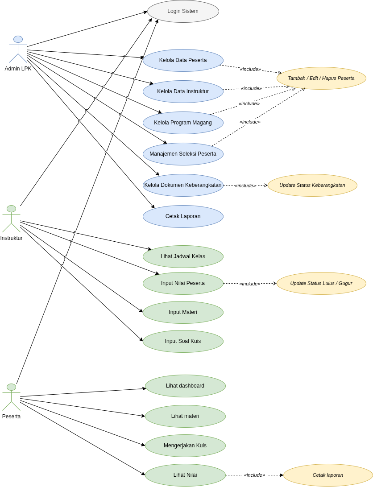
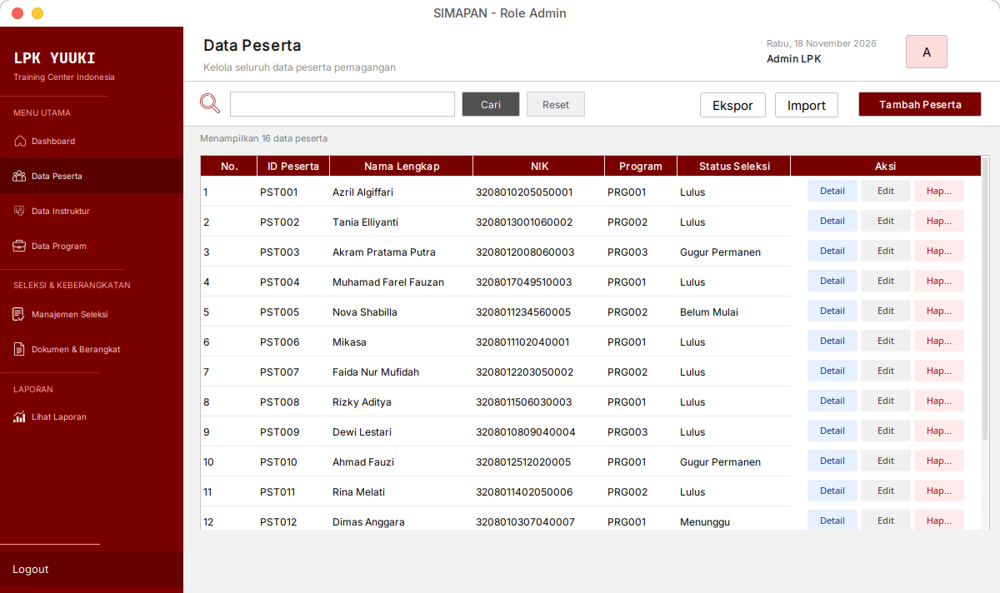
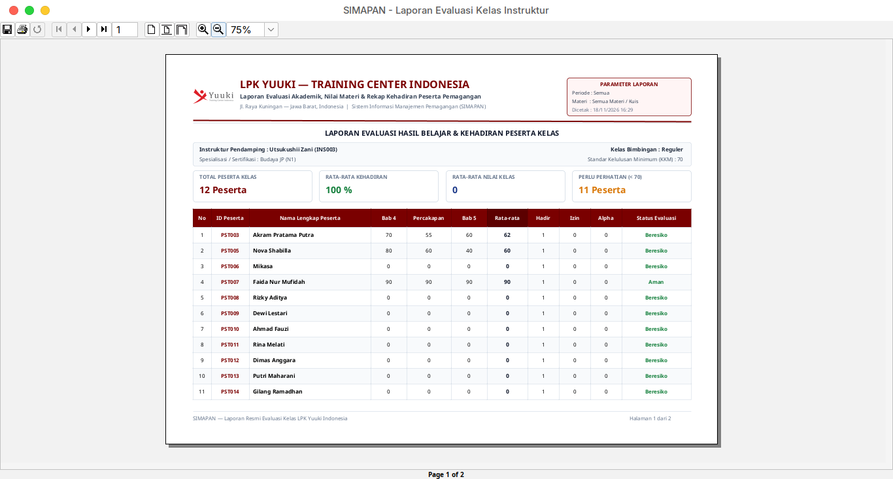

# SIMAPAN — Sistem Informasi Manajemen Pemagangan


**SIMAPAN** adalah aplikasi desktop berbasis **Java Swing** yang dirancang untuk mendigitalisasi pengelolaan pelatihan bahasa, seleksi, dan persiapan pemagangan ke Jepang pada **LPK Yuuki — Training Center Indonesia**.

Aplikasi ini menerapkan arsitektur berlapis (**Model–View–DAO**), penyimpanan persisten menggunakan **MySQL**, pelaporan resmi berbasis **JasperReports**, serta visualisasi data akademik menggunakan **Java 2D (`Graphics2D`)**.

---

## Daftar Isi

- [Arsitektur & Perancangan Sistem](#arsitektur--perancangan-sistem)
- [Fitur Utama Berdasarkan Hak Akses](#fitur-utama-berdasarkan-hak-akses)
- [Pratinjau Aplikasi](#pratinjau-aplikasi)
- [Teknologi yang Digunakan](#teknologi-yang-digunakan)
- [Struktur Direktori Proyek](#struktur-direktori-proyek)
- [Panduan Instalasi & Menjalankan Aplikasi](#panduan-instalasi--menjalankan-aplikasi)
- [Pengembang](#pengembang)

---

## Arsitektur & Perancangan Sistem

### Use Case Diagram

Diagram berikut menggambarkan hak akses dan interaksi fungsional antara tiga aktor utama sistem: **Admin**, **Instruktur**, dan **Peserta**.



<!-- Ganti path gambar di atas sesuai lokasi file Use Case Diagram di repositori Anda -->

---

## Fitur Utama Berdasarkan Hak Akses

### 1. Administrator (`ADMIN`)

- **Manajemen Data Master** — Pengelolaan data Peserta, Instruktur, Program Pemagangan, dan Jadwal Pelatihan.
- **Administrasi Seleksi & Keberangkatan** — Pemantauan status kelulusan seleksi, kelengkapan berkas (KTP, Paspor, MCU, Visa), serta status keberangkatan peserta ke Jepang.
- **Pelaporan Rekapitulasi (JasperReports)** — Ekspor laporan rekapitulasi seluruh data peserta, status pembayaran, seleksi, dan keberangkatan dalam format dokumen resmi (*Landscape*).

### 2. Instruktur (`INSTRUKTUR`)

- **Manajemen Materi & Kuis** — Unggah materi pembelajaran (teks maupun berkas PDF/dokumen) serta pembuatan soal kuis interaktif (Pilihan Ganda dan Essay) berdasarkan kelas target.
- **Penilaian & Evaluasi** — Koreksi otomatis untuk soal Pilihan Ganda, penilaian manual beserta catatan evaluasi untuk soal Essay, dan pencatatan perkembangan belajar peserta.
- **Laporan Evaluasi Kelas (JasperReports)** — Ekspor laporan evaluasi akademik dan rekap kehadiran peserta yang tersinkronisasi dengan filter periode, materi, serta kartu ringkasan KPI kelas.

### 3. Peserta (`PESERTA`)

- **Dashboard Interaktif (Java 2D)**
  - **Stepper Timeline Pemagangan** — Visualisasi alur 4 tahap (*Registrasi → Tes Seleksi → Pelatihan Kelas → Keberangkatan*) secara *real-time*.
  - **Radial Donut Gauge** — Indikator persentase indeks capaian akademik peserta.
  - **Grafik Perkembangan Nilai** — Grafik batang riwayat skor seleksi dan kuis lengkap dengan garis batas kelulusan (**KKM 70**).
- **Pembelajaran & Evaluasi Mandiri** — Akses materi kelas, pengerjaan kuis dengan penghitung waktu mundur, serta pemantauan hasil nilai dan catatan instruktur.
- **Cetak Transkrip Nilai (JasperReports)** — Cetak Kartu Hasil Studi / Transkrip Nilai Peserta lengkap dengan biodata akademik dan pengesahan lembaga.

---

## Pratinjau Aplikasi

| Dashboard Peserta (Java 2D) | Laporan JasperReports |
| :---: | :---: |
|  |  |

---

## Teknologi yang Digunakan

| Kategori | Teknologi |
| :--- | :--- |
| Bahasa Pemrograman | Java (JDK 11 atau lebih baru) |
| Antarmuka Grafis | Java Swing, `AbsoluteLayout`, Java 2D API (`Graphics2D`) |
| Build & Dependency Manager | Apache Maven (`pom.xml`) |
| Database | MySQL / MariaDB (`mysql-connector-j`) |
| Pelaporan | JasperReports (`net.sf.jasperreports`) |

---

## Struktur Direktori Proyek

```text
SIMAPAN/
├── assets/
│   └── images/                  # Gambar dokumentasi (Use Case, screenshot)
├── src/
│   └── main/
│       ├── java/
│       │   ├── DAO/             # Data Access Object (query CRUD MySQL)
│       │   ├── Database/        # Konfigurasi koneksi JDBC (Koneksi.java)
│       │   ├── DataStore/       # Cache state lokal & sinkronisasi sesi
│       │   ├── Model/           # Entitas OOP (Pengguna, Peserta, Instruktur, Kuis, dll.)
│       │   ├── Util/            # Helper utilitas (ReportUtil, dll.)
│       │   └── Views/           # Antarmuka Swing per role (admin, instruktur, peserta)
│       └── resources/
│           └── Reports/         # Template laporan JasperReports (.jrxml)
├── pom.xml                      # Konfigurasi dependensi Maven
└── README.md
```

---

## Panduan Instalasi & Menjalankan Aplikasi

### Langkah 1 — Siapkan Prasyarat Sistem

Pastikan perangkat Anda sudah terpasang:

- **Java Development Kit (JDK) 11 atau lebih baru** — periksa dengan `java -version`.
- **MySQL Server** — dapat menggunakan XAMPP, Laragon, atau instalasi MySQL/MariaDB bawaan sistem operasi.
- **Apache Maven** — sudah terintegrasi otomatis jika menggunakan Apache NetBeans.
- **IDE Java** — Apache NetBeans (direkomendasikan), IntelliJ IDEA, atau VS Code.

### Langkah 2 — Clone Repositori

```bash
git clone https://github.com/arell74/SIMAPAN.git
cd SIMAPAN
```

### Langkah 3 — Konfigurasi Database MySQL

1. Jalankan layanan MySQL di komputer Anda.
2. Buka phpMyAdmin atau klien MySQL terminal, lalu buat database baru:

   ```sql
   CREATE DATABASE simapan;
   ```

3. Impor file skema `simapan.sql` (tersedia di halaman **Releases**) ke dalam database `simapan`:

   ```bash
   mysql -u root -p simapan < simapan.sql
   ```

4. Buka `src/main/java/Database/Koneksi.java`, lalu sesuaikan `URL`, `USER`, dan `PASS` jika konfigurasi MySQL lokal Anda berbeda:

   ```java
   private static final String URL  = "jdbc:mysql://localhost:3306/simapan?useSSL=false&allowPublicKeyRetrieval=true&serverTimezone=Asia/Jakarta";
   private static final String USER = "root";
   private static final String PASS = "";
   ```

### Langkah 4 — Build & Jalankan Aplikasi

#### Opsi A — Apache NetBeans (Direkomendasikan)

1. Buka Apache NetBeans, klik **File → Open Project...**, lalu pilih folder `SIMAPAN`.
2. Tunggu hingga NetBeans selesai memuat konfigurasi proyek Maven.
3. Klik kanan proyek **SIMAPAN** di panel *Projects* → **Clean and Build**. Langkah ini mengunduh seluruh dependensi (`mysql-connector-j` dan `jasperreports`) serta menyalin template `.jrxml` ke `target/classes`.
4. Klik kanan proyek **SIMAPAN** → **Run** (atau tekan `F6`).

#### Opsi B — Terminal (Maven CLI)

1. Build paket dari direktori utama proyek:

   ```bash
   mvn clean package
   ```

2. Jalankan aplikasi melalui Maven exec:

   ```bash
   mvn exec:java -Dexec.mainClass="Views.FormLogin"
   ```

   > **Catatan:** Sesuaikan `-Dexec.mainClass` dengan nama package dan kelas utama login pada proyek Anda jika berbeda.

---

## Pengembang

**Muhamad Farel Fauzan**
Program Studi Teknik Informatika, Fakultas Ilmu Komputer, Universitas Kuningan

GitHub: [@arell74](https://github.com/arell74)